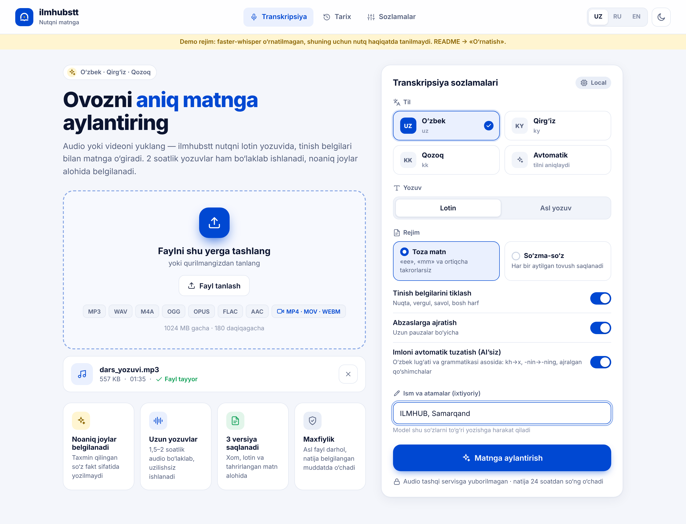
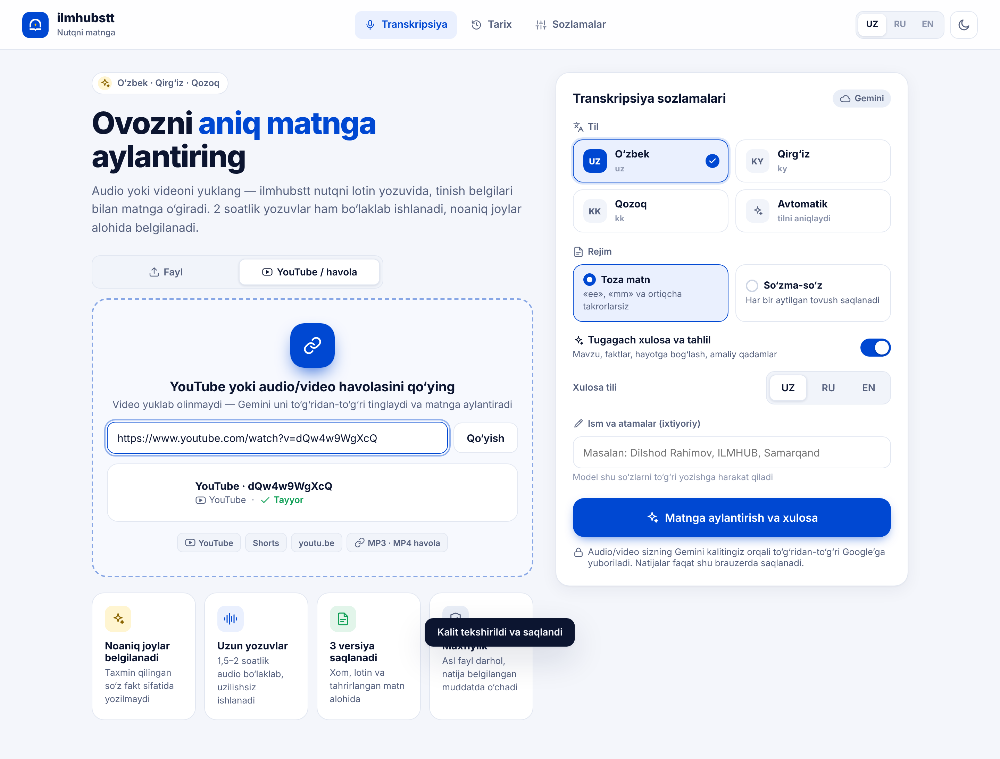

# ilmhubstt — o‘zbek, qirg‘iz va qozoq nutqini matnga aylantirish

Telefon va kompyuter brauzerida ishlaydigan veb-platforma. Audio yoki videoni yuklaysiz — server nutqni
lotin yozuvida, tinish belgilari bilan matnga o‘giradi. 1,5–2 soatlik yozuvlar bo‘laklab, uzilishsiz ishlanadi.
Natijani brauzerda tahrirlab, TXT (UTF-8), SRT, VTT yoki JSON qilib yuklab olasiz.



## Imkoniyatlar

- **Tillar:** o‘zbek, qirg‘iz, qozoq + avtomatik aniqlash. Interfeys: o‘zbek, rus, ingliz. Yorug‘/tungi mavzu.
- **Formatlar:** MP3, WAV, M4A, OGG, OPUS, FLAC, AAC, MP4, MOV, WEBM, MKV va FFmpeg o‘qiy oladigan boshqalar.
  Format kengaytma bo‘yicha emas, FFprobe orqali tekshiriladi.
- **Uzun audio:** pauzalar bo‘yicha ~10 daqiqalik bo‘laklarga bo‘linadi; har bo‘lak diskka saqlanadi.
  Server o‘chib qolsa, ish shu joydan davom etadi. Progress va qolgan vaqt real hisoblanadi.
- **3 versiya:** xom (ASR), lotin/tozalangan va tahrirlangan matn alohida saqlanadi.
- **Noaniq joylar:** ishonchi past so‘zlar sariq rangda belgilanadi, taxmin fakt sifatida yozilmaydi.
  So‘zni bossangiz audio shu joydan ijro etiladi.
- **Rejimlar:** «Toza matn» («ee», «mm» va 3+ marta takrorlarsiz) yoki «So‘zma-so‘z».
- **Ism va atamalar:** maydonga yozilgan so‘zlar modelga yo‘naltiruvchi sifatida beriladi.
- **Maxfiylik:** asl fayl konvertatsiyadan keyin darhol o‘chadi; natija `RETENTION_HOURS` dan keyin o‘chadi.
  Har bir ishga alohida maxfiy token beriladi; ixtiyoriy kirish kaliti, so‘rovlar chegarasi va xavfsizlik sarlavhalari bor.

## YouTube havola va «Xulosa va tahlil» (yangi)



- **YouTube / havola** bo‘limiga YouTube havolasini (watch, youtu.be, Shorts, live) yoki audio/video faylga
  to‘g‘ridan-to‘g‘ri havolani qo‘yasiz. Video **yuklab olinmaydi va MP3 ga aylantirilmaydi** — Gemini YouTube
  videosini o‘zi to‘g‘ridan-to‘g‘ri tinglaydi (Google’ning rasmiy imkoniyati; YouTube qoidalarini buzmaydi).
  Faqat **ochiq (public)** videolar ishlaydi.
- Uzun yozuvlar avtomatik bo‘lib yoziladi: javob uzilsa (token chegarasi) shu joydan davom ettiriladi,
  katta fayllar Google Files API’ga yuklanib 15 daqiqalik parchalarda yoziladi. Sahifa yopilib qolsa —
  «Davom ettirish» tugmasi saqlangan joydan davom ettiradi.
- **Xulosa va tahlil** (har qanday natijada, «Xulosa» tabi): nima haqida, asosiy g‘oya, kimlar uchun foydali,
  asosiy fikrlar, vaqt bo‘yicha bo‘limlar (bosilsa video/audio o‘sha joydan ijro), keltirilgan faktlar
  (tekshirish kerak bo‘lganlari belgilanadi), hayotga bog‘lash, **nimalar qilish kerak** (belgilanadigan ro‘yxat),
  iqtiboslar, atamalar, savollar va yakuniy xulosa. O‘zbek/rus/ingliz tilida. Nusxa yoki `.md` qilib yuklab olinadi.
- Bu qism **foydalanuvchining o‘z Gemini kaliti bilan, to‘g‘ridan-to‘g‘ri brauzerdan** ishlaydi (BYOK).
  Kalit faqat foydalanuvchi brauzerida saqlanadi va faqat `generativelanguage.googleapis.com` ga yuboriladi.

Narx (taxminiy, pullik tarifda): 1 soatlik audio ≈ $0,12–0,20, YouTube video (past sifatli kadr) ≈ $0,2–0,4,
xulosa ≈ $0,01–0,03. Bepul kalitda — bepul, lekin kunlik limitlar bor (YouTube: kuniga ~8 soat).

## Internetga joylash: GitHub → Vercel (hamma o‘z kaliti bilan foydalanadi)

Vercel’da **serversiz (brauzer) versiya** ishlaydi: YouTube/havola/fayl → Gemini → matn → xulosa. Har bir
foydalanuvchi saytga kirib o‘zining Gemini kalitini kiritadi; sizga hech qanday xarajat yo‘q.

> Nega to‘liq server Vercel’da emas? Vercel funksiyalari 4,5 MB so‘rov va 300 soniya vaqt chegarasiga ega,
> FFmpeg, fon jarayoni va disk yo‘q — lokal Whisper/Ollama va 2 soatlik server ishlovi u yerda ishlamaydi.
> To‘liq server versiyasi uchun VPS + Docker: `docs/DEPLOY.md`.

1. GitHub’da yangi **bo‘sh** repozitoriy oching (masalan `ilmhubstt`).
2. Loyiha papkasida (VS Code terminalida):
   ```
   git init -b main          (zip ichida tayyor bo‘lsa, bu qadamni o‘tkazib yuboring)
   git add .
   git commit -m "ilmhubstt"
   git remote add origin https://github.com/FOYDALANUVCHI/ilmhubstt.git
   git push -u origin main
   ```
3. https://vercel.com → **Add New… → Project** → GitHub’dagi `ilmhubstt` ni tanlang → **Deploy**.
   Hech narsa sozlash shart emas: `vercel.json` build buyrug‘i (`node build.mjs --static`), chiqish papkasi
   (`frontend/dist`) va xavfsizlik sarlavhalarini o‘zi beradi. Root Directory — bo‘sh (repo ildizi) qolsin.
4. 1–2 daqiqada `https://ilmhubstt.vercel.app` kabi manzil chiqadi. Keyingi har `git push` avtomatik yangilaydi.
5. Sinov: saytni oching → kalitni kiriting → qisqa ochiq YouTube videosi bilan tekshiring.

Foydalanuvchilarga eslatma: kalitni https://aistudio.google.com/app/apikey dan olinadi. Umumiy kompyuterda
«eslab qolish» belgisini olib tashlang yoki ishdan keyin Sozlamalar → «Kalitni o‘chirish».

## Tez boshlash (Windows)

1. **Python 3.11** — https://www.python.org/downloads/ («Add python.exe to PATH» belgisini qo‘ying).
2. **FFmpeg** — PowerShell yoki CMD’da: `winget install --id Gyan.FFmpeg -e`. So‘ng oynani yopib, yangisini oching.
3. Loyiha papkasida `scripts\setup_windows.bat` ni ikki marta bosing.
4. `scripts\run_windows.bat` — brauzerda http://127.0.0.1:8000 ochiladi.
5. **Telefondan foydalanish:** `scripts\run_lan_windows.bat` ni ishga tushiring. Telefon bir Wi-Fi tarmog‘ida bo‘lsin.
   Batafsil: [docs/DEPLOY.md](docs/DEPLOY.md).

> **Muhim:** birinchi transkripsiyada model internetdan bir marta yuklanadi — sayt buni MB va tezlik bilan ko‘rsatadi.
> Internet sekin bo‘lsa, modelni oldindan terminalda yuklab oling:
> `cd backend` → `.venv\Scripts\python.exe download_model.py small` (yoki `medium`).
> NVIDIA GPU bo‘lsa, dastur uni avval alohida sinaydi; CUDA kutubxonalari bo‘lmasa avtomatik CPU ishlatadi.
> GPU’ni yoqish uchun: `.venv\Scripts\python.exe -m pip install nvidia-cublas-cu12 "nvidia-cudnn-cu12==9.*"`.
>
> Birinchi transkripsiyada model internetdan bir marta yuklanadi va `models/` papkasida saqlanadi.
> Hajmi: small ≈ 0,5 GB, medium ≈ 1,5 GB, large-v3-turbo ≈ 1,6 GB (taxminan). Keyin internetsiz ishlaydi.

Linux/macOS: `scripts/setup.sh`, so‘ng `scripts/run.sh` (telefon uchun: `scripts/run.sh --lan`).

## O‘zbekcha uchun aniq natija (MUHIM)

Oddiy Whisper (small/medium/large) o‘zbek tilini **yomon** taniydi: so‘zlar buziladi, turkcha/qozoqcha harflar aralashadi.
Shuning uchun o‘zbekchaga maxsus o‘qitilgan ochiq modelni ulang — **rubaiSTT v2** (`islomov/rubaistt_v2_medium`,
Whisper medium fine-tune, Apache-2.0, ~475 soat o‘zbekcha nutq, jumladan Toshkent shevasidagi podkastlar):

```
cd backend
.venv\Scripts\python.exe setup_uzbek_model.py
```
(yoki `scripts\setup_uzbek_model_windows.bat`). Skript modelni yuklaydi, faster-whisper formatiga o‘giradi,
sinab ko‘radi va `.env` ga `WHISPER_MODEL_UZ=...` yozadi. Keyin serverni qayta ishga tushiring — o‘zbek tili
tanlanganda sayt yashil «maxsus model ishlatiladi» belgisini ko‘rsatadi.

Mustaqil o‘lchovlar (alphacep/awesome-speech): rubaiSTT WER ~8,5% (Common Voice), ~12% (ISSAI), ~25% (Ovozify — og‘ir audio).
Podkast benchmarki (uzbek-stt-bench, ep40): Gemini 3 Flash 15,3%, Muxlisa 22,2%, ElevenLabs Scribe 24,9%.
O‘z audiongizda o‘lchang: `python scripts/real_asr_check.py --audio x.mp3 --ref x.txt --language uz`.

## Google Gemini — eng aniq natija (bepul yoki pullik kalit)

O‘zbekcha podkastlar benchmarkida eng kam xato Gemini’da. ilmhubstt’da u alohida dvigatel sifatida ishlaydi.

**Ulash (2 daqiqa):**
1. https://aistudio.google.com/app/apikey → **Create API key** (bepul, karta shart emas).
2. Saytda **Sozlamalar → Gemini API kaliti** → kalitni qo‘ying → **Tekshirish va saqlash**.
   Kalit tekshiriladi va `.env` faylga o‘zi yoziladi (qo‘lda tahrirlash shart emas).
3. Bosh sahifada dvigatel avtomatik **«Gemini (Google, eng aniq)»** ga o‘tadi.

**Qanday ishlaydi:**
- Audio ~10 daqiqalik bo‘laklarga (pauzada) bo‘linadi, siqiladi va Gemini’ga yuboriladi. Har bir bo‘lakdan
  vaqt belgili gaplar (JSON) olinadi. 2 soatlik fayl ≈ 12 so‘rov.
- **Limit (429) yoki server bandligi:** sayt «Gemini limiti: kutilmoqda» deb ko‘rsatadi va o‘zi qayta urinadi.
  Jami `GEMINI_MAX_WAIT` (standart 15 daqiqa) dan oshsa, aniq xato chiqaradi. Tayyor bo‘laklar saqlanib qoladi.
- Model nomi o‘zgarsa yoki topilmasa, zaxira modelga (`gemini-2.5-flash`…) o‘tadi.
- Natijada model nomi, sarflangan tokenlar va **taxminiy narx** ko‘rsatiladi.
- Kalitni faqat server o‘rnatilgan kompyuterdan (yoki kirish kaliti bilan) o‘zgartirish mumkin.

**Narx (taxminiy, 2026-yil oktabr):** Gemini 3 Flash — 1 soat ≈ $0,19, $10 ≈ 50 soat.
Bepul tarifda kunlik so‘rovlar cheklangan va Google ma’lumotdan foydalanishi mumkin.
Pullik tarifda (billing ulangan) ma’lumot o‘qitishga ishlatilmaydi. **Maxfiy yozuvlar uchun lokal dvigatelni tanlang.**

## Lokal AI muharrir — Gemini darajasidagi tahrir, internetsiz va tekin

Gemini kabi gap mazmunini tushunib imlo, tinish belgisi va bosh harflarni to‘g‘rilash uchun ilmhubstt
kompyuteringizdagi **lokal til modelidan** foydalanadi (Ollama orqali). Audio ham, matn ham kompyuterdan chiqmaydi,
API kalit va to‘lov kerak emas.

**O‘rnatish (bir marta):** `scripts\setup_ai_editor_windows.bat` ni ishga tushiring. U quyidagilarni bajaradi:
```
winget install --id Ollama.Ollama -e
ollama pull gemma3:12b        # ~8 GB; video xotira 8 GB dan kam bo‘lsa: gemma3:4b (~3 GB)
```
Keyin ilmhubstt serverini qayta ishga tushiring. Bosh sahifada **«AI muharrir (lokal, internetsiz)»** tugmasi paydo bo‘ladi.

**Qanday ishlaydi:**
- Matn abzas-abzas modelga beriladi. Modelga qat’iy ko‘rsatma beriladi: «faqat imlo, tinish belgisi, bosh harf
  va noto‘g‘ri eshitilgan so‘zlarni tuzat; ma’noni o‘zgartirma, gap qo‘shma, o‘chirma».
- **Har bir javob tekshiriladi.** So‘zlar soni ±20% dan ko‘p o‘zgarsa, raqamlar o‘zgarsa, kirill yozuviga o‘tib ketsa
  yoki matn juda boshqacha bo‘lib qolsa, javob **rad etiladi** va o‘sha abzas o‘zgarmay qoladi.
- Tuzatishlar so‘zlar darajasida vaqt belgilariga qaytarib bog‘lanadi. Natijada AI tuzatgan so‘zlar ko‘k chiziq
  bilan ko‘rinadi, asl shakli saqlanadi. Pleyer, SRT/VTT eksport ishlayveradi.
- Ollama ishlamasa ham ish to‘xtamaydi: matn AI’siz tuzatuvchi bilan tayyorlanadi va bu haqida ogohlantirish chiqadi.

**Model tanlash** (`.env` → `OLLAMA_MODEL`):

| Model | Hajmi | Qachon |
|---|---|---|
| `gemma3:12b` (standart) | ~8 GB | NVIDIA 8 GB+ video xotira yoki 16 GB+ RAM |
| `gemma3:4b` | ~3 GB | Kuchsizroq kompyuter (sifat pastroq) |
| O‘zbekchaga moslangan Llama 3.1 8B (GGUF) | ~5 GB | Sinab ko‘rish uchun: `ollama pull hf.co/mradermacher/uzbek-llama-3.1-8B-instruct-v1-GGUF:Q4_K_M` |

**Halol eslatma:** lokal model Gemini’dan ancha kichik, shuning uchun natija aynan Gemini darajasida bo‘lishi
kafolatlanmaydi. Lekin oddiy Whisper + AI’siz tuzatuvchidan sezilarli yaxshi bo‘ladi.
Eng yaxshi tekin zanjir: **rubaiSTT** (`setup_uzbek_model.py`) → AI’siz tuzatuvchi → lokal AI muharrir.
Tezlik: GPU’da 1 soatlik matn taxminan 3–10 daqiqa, faqat CPU’da ancha sekin (30+ daqiqa bo‘lishi mumkin).

## AI’siz avtomatik imlo tuzatish (o‘zbek)

Oddiy Whisper o‘zbekchani ko‘pincha turkcha/qozoqcha harflar bilan, buzib yozadi. Masalan:
«Kyuzgi tatil davrida farzandim nin khayatı, khafsizligini tamillash doğrısı da».
ilmhubstt bunday matnni **hech qanday AI yoki internetsiz**, qoidalar asosida tuzatadi:
«Kuzgi ta’til davrida farzandimning hayoti, xavfsizligini ta’minlash to‘g‘risida».

Qanday ishlaydi (`backend/app/services/uz_morph.py`, `uz_corrector.py`):
1. **Harflar:** ç→ch, ş→sh, ğ→g‘, ı→i, ö→o‘, ü→u, kh→x, tsh→ch (bu harflar o‘zbek lotin alifbosida yo‘q).
2. **Lug‘at + grammatika:** so‘z = o‘zak + qo‘shimchalar (-lar, -im, -ning, -ga, -dan, -moqda, -gan, -lik…),
   unli/undoshdan keyingi shakllar (o‘qib / qilib), -lovchi, -uvchi, undosh almashinuvi (yurak → yuragi).
3. **Whisper xatolari jadvali:** a↔o, k↔q, x↔h, -nin→-ning, uk→o‘q, ay→oi, tushib qolgan tutuq (ta’til)…
   Eng arzon to‘g‘ri variant tanlanadi.
4. **Ajralgan / yopishgan so‘zlar:** «transporti dan» → «transportidan», «etişxamda» → «etish hamda»,
   «ota anasi» → «ota-onasi».
5. **Xavfsizlik:** hujjatdagi xatolar ulushi o‘lchanadi. Matn sifatli bo‘lsa (masalan, rubaiSTT natijasi),
   faqat ishonchi past so‘zlar tuzatiladi. Lug‘atda yo‘q, lekin to‘g‘ri so‘zlarga tegilmaydi.
   Ismlar, raqamlar va «Ism va atamalar» maydonidagi so‘zlar o‘zgartirilmaydi.
   Tuzatib bo‘lmaydigan so‘z **taxmin qilinmaydi**: u sariq «noaniq» belgisi bilan qoladi.
6. **Shaffoflik:** natijada tuzatilgan so‘zlar yashil chiziq bilan ko‘rsatiladi, bosilganda asl ASR shakli chiqadi.
   Xom (ASR) matn har doim alohida saqlanadi.
7. **O‘rganadi:** «Tahrirlangan» bo‘limida qo‘lda yozgan so‘zlaringiz `data/user_lexicon.txt` ga qo‘shiladi.
   Keyingi safar ular to‘g‘ri deb hisoblanadi. Faylga o‘zingiz ham so‘z yozishingiz mumkin (har qatorda bitta).

Bosh sahifadagi «Imloni avtomatik tuzatish (AI’siz)» tugmasi bilan o‘chirib-yoqiladi.
Cheklov: juda qattiq buzilgan so‘zlarni (masalan, «vasagligi» ← «salomatligi») qoida bilan tiklab bo‘lmaydi.
Eng yaxshi natija — rubaiSTT modeli + shu tuzatuvchi birga ishlaganda.

## Model tanlash va tezlik (CPU)

| Interfeysda | Model | Qachon |
|---|---|---|
| Tez | `small` | Kuchsiz kompyuter, tez qoralama kerak |
| Muvozanat (standart) | `medium` | Ko‘p hollarda sifat va tezlik muvozanati |
| Eng aniq | `large-v3-turbo` | Sifat muhim, kuchli CPU yoki GPU bor |

**2 soatlik audio uchun taxminiy vaqt.** Bu raqamlar sinalmagan — kompyuteringizga qarab keskin farq qiladi:

- 8 yadroli zamonaviy CPU: small — taxminan 20–40 daqiqa, medium — 1–2 soat, large-v3-turbo — 1,5–3 soat.
- NVIDIA GPU (`WHISPER_DEVICE=cuda`): odatda 5–20 daqiqa.

O‘z kompyuteringizda aniq o‘lchash: `python scripts/real_asr_check.py --audio namuna.mp3 --ref namuna.txt`.
Skript tezlikni (realtime koeffitsienti) va WER/CER aniqligini chiqaradi.

O‘zbekchaga maxsus o‘qitilgan (fine-tune) Whisper model topsangiz, uni CTranslate2 formatiga o‘tkazib ulashingiz mumkin:
`.env` → `WHISPER_MODEL_UZ=C:\models\...`. Bu odatda aniqlikni sezilarli oshiradi.

## Tekin va pullik yo‘llar

| Yo‘l | Narx | Sifat va cheklov |
|---|---|---|
| **O‘z kompyuteringizda faster-whisper** (standart) | Tekin | Audio hech qayerga ketmaydi. CPU’da 2 soatlik fayl uzoq ishlanadi. Qirg‘iz tili rasmiy qo‘llanmaydi |
| Telefon orqali LAN yoki Cloudflare Tunnel | Tekin | Kompyuter yoqiq turishi kerak |
| **ElevenLabs Scribe** (ichiga ulangan, ixtiyoriy) | Scribe v2: soatiga $0,22 → 2 soat ≈ $0,44. Bepul tarifda oyiga bir necha soat (tarif sahifasida tekshiring) | Uchala tilni qo‘llaydi (qirg‘iz ham), bitta faylda 10 soatgacha. Audio tashqi servisga yuboriladi |
| GPU server ijarasi | Soatbay to‘lov | Tez; o‘zingiz boshqarasiz |
| OpenAI (whisper-1 / gpt-4o-transcribe) | daqiqasiga $0,006 → 2 soat ≈ $0,72 | Ulanmagan. Bitta so‘rovga 25 MB chegara, qirg‘iz tili yo‘q |

Narxlar 2026-yil noyabrda tekshirilgan, o‘zgarishi mumkin.
ElevenLabs’ni yoqish uchun `.env` ga `ELEVENLABS_API_KEY=...` qo‘ying — interfeysda «ElevenLabs (bulut)» tanlovi paydo bo‘ladi.

## Ma’lum cheklovlar (halol)

- 100% xatosiz transkripsiya kafolatlanmaydi. Sheva, shovqin, bir vaqtda gapirish, ism va atamalarda xato bo‘lishi mumkin.
- Whisper’da **qirg‘iz tili yo‘q**. Lokal rejimda qozoq sozlamasi bilan tanilgani uchun sifat pastroq bo‘ladi.
  Interfeys buni ogohlantiradi. Aniqroq natija uchun ElevenLabs yoki qirg‘izcha model kerak.
- Tinish belgilari model natijasidan olinadi va tozalanadi; alohida punktuatsiya modeli yo‘q.
- Haqiqiy nutq bilan sifat testi sizning audiolaringizda o‘tkazilishi kerak. Nimalar sinalgani va nimalar sinalmagani:
  [docs/TEST_REPORT.md](docs/TEST_REPORT.md).

## API

| Metod | Yo‘l | Tavsif |
|---|---|---|
| POST | `/api/v1/jobs` | multipart: `file, language(uz/ky/kk/auto), script(latin/original), mode(clean/verbatim), punctuation, paragraphs, quality(fast/balanced/best), engine, vocabulary` → `{job_id, status, token}` |
| GET | `/api/v1/jobs/{id}` | holat: `status, stage, progress, eta_seconds, queue_position, preview, error` |
| GET | `/api/v1/jobs/{id}/result` | `raw_text, latin_text, edited_text, segments[words…], stats, warnings` |
| PATCH | `/api/v1/jobs/{id}/result` | `{edited_text}` |
| GET | `/api/v1/jobs/{id}/export?format=txt\|txt_ts\|srt\|vtt\|json` | fayl (UTF-8) |
| GET | `/api/v1/jobs/{id}/audio` | ijro uchun yengil audio (Range qo‘llanadi) |
| POST | `/api/v1/jobs/{id}/cancel` | bekor qilish |
| DELETE | `/api/v1/jobs/{id}` | o‘chirish |
| GET | `/api/v1/config`, `/api/v1/health` | sozlamalar va holat |

Ishga oid so‘rovlarda `X-Job-Token` sarlavhasi kerak. Kirish kaliti yoqilgan bo‘lsa, `X-Access-Key` sarlavhasi ham kerak.

Holatlar: `queued → converting → transcribing → normalizing → completed | failed | cancelled`.

## Loyiha tuzilishi

```
backend/app/        main.py, config.py, api/, services/ (ffmpeg, chunking, asr + engines/, transliteration,
                    punctuation, proofreading, text_pipeline, export), workers/, storage/ (SQLite), security/
backend/tests/      pytest: unit, FFmpeg formatlar, API integratsiya, 2 soatlik yuklama (-m slow)
frontend/src/       React + TypeScript (pages/, components/, services/, hooks/, styles/, i18n.ts)
frontend/dist/      tayyor build — backend shu papkani beradi (Node.js shart emas)
frontend/src/services/  gemini.ts (brauzerdan Gemini, Files API), cloud.ts (YouTube/havola/fayl ishlari), summary.ts, idb.ts
frontend/tests/     brauzer mantiqining unit testlari (node tests/run.mjs)
scripts/            Windows/Linux o‘rnatish va ishga tushirish, real_asr_check.py, e2e_browser.py,
                    e2e_cloud.py + fake_gemini.py (brauzer rejimi E2E, soxta Gemini bilan)
vercel.json         Vercel uchun statik (BYOK) build sozlamasi
docs/               DEPLOY, TRANSLITERATION, TEST_REPORT, skrinshotlar, dizayn
```

## Dasturchilar uchun

```
cd backend
.venv\Scripts\python -m pip install -r requirements-dev.txt
.venv\Scripts\python -m pytest              # 122 test
.venv\Scripts\python -m pytest -m slow      # 2 soatlik yuklama testi
```

Frontend’ni o‘zgartirsangiz (Node.js LTS kerak): `cd frontend && npm install && npm run build`.
Vercel versiyasini lokal ko‘rish: `npm run build:static`, so‘ng `npx serve dist` (yoki `python -m http.server -d dist`).
Brauzer mantiqi testlari: `npm test`. Brauzer rejimi E2E: `python scripts/e2e_cloud.py` (avval `build:static`).

Interfeysni model o‘rnatmasdan sinash uchun `.env` ga `ENABLE_DUMMY_ENGINE=1` qo‘ying.
Bu demo dvigatel nutqni **tanimaydi**, faqat interfeysni tekshirish uchun.

Backend Starlette + Uvicorn’da yozilgan. FastAPI ham shu Starlette ustiga qurilgan. Kerak bo‘lsa, `api/` dagi
handler’larni FastAPI router’ga o‘tkazish oson.
